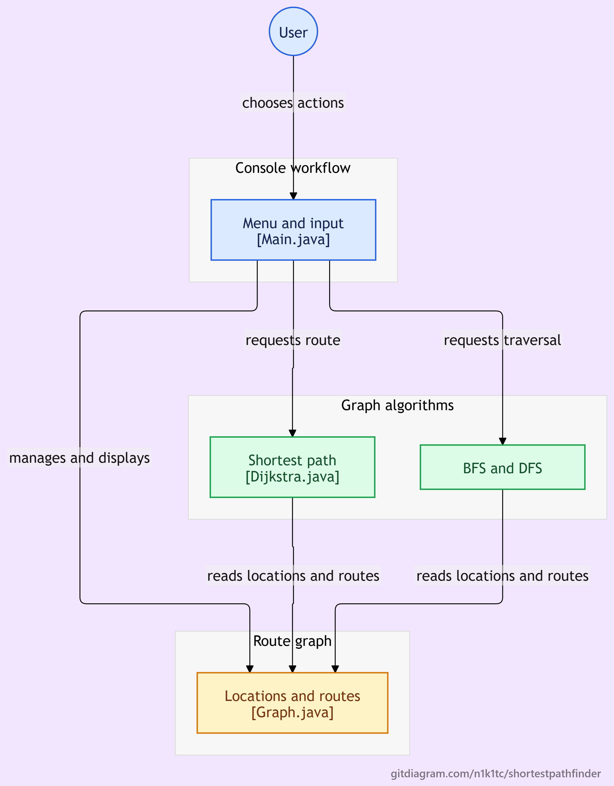

# Shortest Path Finder Using Graph Algorithms in Java

A menu-driven Java application that models locations and routes as a graph, finds the shortest path between locations using Dijkstra's algorithm, and performs graph traversals using BFS and DFS.

## Table of Contents

- [Project Overview](#project-overview)
- [Workflow Diagram](#workflow-diagram)
- [Objectives](#objectives)
- [Features](#features)
- [Technologies Used](#technologies-used)
- [Algorithms Implemented](#algorithms-implemented)
- [Project Structure](#project-structure)
- [Getting Started](#getting-started)
- [Sample Graph and Output](#sample-graph-and-output)
- [Screenshots](#screenshots)
- [Time Complexity](#time-complexity)
- [Future Improvements](#future-improvements)
- [Conclusion](#conclusion)

## Project Overview

The **Shortest Path Finder** is a console-based Java application that represents locations as vertices and routes as weighted edges in a graph. Each route has a distance measured in kilometres.

Users can add locations, connect them with routes, display the graph, find the shortest path between two locations, and explore the graph using Breadth-First Search (BFS) and Depth-First Search (DFS).

The project demonstrates how graph data structures and algorithms can be applied to route-finding problems.

## Workflow Diagram

The following diagram illustrates the interaction between the user, the console menu, the graph algorithms, and the graph data structure.



## Objectives

- Represent locations and routes using a graph data structure.
- Find the minimum-distance path between two locations.
- Implement Dijkstra's shortest-path algorithm.
- Perform BFS and DFS graph traversals.
- Allow users to add locations and routes dynamically.
- Display graph connections and their distances.
- Handle invalid locations and route inputs.

## Features

- **Add Location:** Add a new location to the graph.
- **Add Route:** Connect two existing locations with a specified distance.
- **Display Graph:** View locations and their neighbouring locations with route distances.
- **Find Shortest Path:** Calculate and display the shortest route and its total distance.
- **BFS Traversal:** Explore the graph level by level.
- **DFS Traversal:** Explore paths deeply before backtracking.
- **Load Sample Graph:** Load predefined locations and routes for testing.
- **Input Validation:** Handle invalid locations, duplicate locations, and invalid route values.

## Technologies Used

| Technology | Purpose |
|---|---|
| Java | Application development |
| JDK | Compilation and execution |
| Visual Studio Code | Development environment |
| Git | Version control |
| GitHub | Source code hosting |

### Data Structures Used

- `LinkedHashMap` — Stores locations and their neighbouring routes while preserving insertion order.
- `Map` — Represents the graph's adjacency list and route distances.
- `Set` — Tracks visited locations during graph traversal.
- `Queue` / `ArrayDeque` — Supports BFS traversal.
- `PriorityQueue` — Selects the next location with the smallest tentative distance in Dijkstra's algorithm.
- `LinkedList` — Reconstructs the shortest path.
- `HashMap` — Stores distance and predecessor information in Dijkstra's algorithm.

## Algorithms Implemented

### 1. Dijkstra's Algorithm

Dijkstra's algorithm calculates the shortest path between a source location and a destination in a weighted graph with non-negative edge weights.

**How it works:**

1. Assign a distance of zero to the source and infinity to all other locations.
2. Use a priority queue to select the location with the smallest tentative distance.
3. Examine its neighbouring locations and update distances whenever a shorter route is found.
4. Store predecessor information to reconstruct the shortest path.
5. Display the path and its total distance.

The implementation uses a priority queue to efficiently select the next location to process.

### 2. Breadth-First Search (BFS)

BFS visits locations level by level, exploring immediate neighbours before moving farther away.

It uses a queue and a visited set to avoid processing the same location repeatedly.

BFS is used here for graph traversal; it does not calculate the minimum-distance path for weighted routes.

### 3. Depth-First Search (DFS)

DFS explores one path as deeply as possible before backtracking.

The implementation uses recursion and a visited set to traverse connected locations without repeatedly visiting the same location.

## Project Structure

```text
ShortestPathFinder/
├── docs/
│   └── workflow.png
├── screenshots/
│   ├── Add Location.jpeg
│   ├── Add Route.jpeg
│   ├── BFS Traversal.jpeg
│   ├── DFS Traversal.jpeg
│   ├── Display Graph.jpeg
│   ├── Find Shortest Path.jpeg
│   └── ...
├── src/
│   ├── Main.java
│   ├── Graph.java
│   ├── Dijkstra.java
│   └── GraphTraversal.java
├── .gitignore
└── README.md
```

- `Main.java` — Displays the menu and handles user interaction.
- `Graph.java` — Manages locations, routes, and graph display.
- `Dijkstra.java` — Implements shortest-path calculation.
- `GraphTraversal.java` — Implements BFS and DFS.
- `docs/workflow.png` — Illustrates the application's workflow.
- `screenshots/` — Contains screenshots of application features and test results.
- `.gitignore` — Excludes generated and unnecessary files from version control.

## Getting Started

### Prerequisites

- Java Development Kit (JDK) installed.
- Visual Studio Code or another Java-compatible editor.
- Git, if you want to clone the repository.

Verify your Java installation:

```bash
java -version
javac -version
```

### Clone the Repository

```bash
git clone https://github.com/n1k1tc/ShortestPathFinder.git
cd ShortestPathFinder
```

### Compile the Project

From the project root directory, run:

```bash
javac src/*.java
```

### Run the Application

```bash
java -cp src Main
```

Follow the on-screen menu to add locations, create routes, display the graph, find shortest paths, or perform traversals.

## Sample Graph and Output

The application includes a sample graph with four locations: A, B, C, and D.

The routes are:

| Source | Destination | Distance |
|---|---|---:|
| A | B | 4 km |
| A | C | 2 km |
| B | D | 3 km |
| C | D | 1 km |

The graph is undirected, so each route can be traversed in either direction.

### Example: Shortest Path from A to D

**Possible routes:**

- A → B → D = 4 + 3 = 7 km
- A → C → D = 2 + 1 = 3 km

**Expected output:**

```text
--- Shortest Path Result ---
Shortest Path: A -> C -> D
Total Distance: 3 km
```

Dijkstra's algorithm selects A → C → D because its total distance is the smallest.

## Screenshots

The repository's `screenshots/` directory contains examples of the application's main features, including:

- Adding locations and routes
- Displaying graph connections
- Finding shortest paths
- BFS traversal
- DFS traversal
- Loading the sample graph
- Handling invalid source and destination inputs

These screenshots demonstrate the application's behaviour during testing.

## Time Complexity

Let \(V\) be the number of locations (vertices) and \(E\) be the number of routes (edges).

| Algorithm | Time Complexity | Purpose |
|---|---|---|
| Dijkstra's algorithm with a priority queue | \(O((V+E)\log V)\) | Finds the shortest path |
| BFS | \(O(V+E)\) | Traverses the graph level by level |
| DFS | \(O(V+E)\) | Traverses the graph depth-first |

The adjacency-list representation requires \(O(V+E)\) space.

## Future Improvements

Possible extensions include:

- A graphical user interface (GUI).
- Visual representation of locations and routes.
- Support for directed graphs.
- Importing and saving graph data.
- Displaying alternative routes.
- Allowing users to choose different distance units.

## Conclusion

The Shortest Path Finder demonstrates the practical use of graph data structures and algorithms in Java. Dijkstra's algorithm finds minimum-distance routes, while BFS and DFS provide complementary graph traversal methods.

The project also demonstrates object-oriented programming, collections, input handling, modular code organisation, and version control with Git and GitHub.

---

**Developed as a Java graph-algorithms project.**